# Lab 3 — Deploying a 5G Standalone Network Using OpenAirInterface

**Student Name:** Lucy  
**Student ID:** M11502215

---

## 1. Objective

This lab deploys a 5G Standalone (SA) network using OpenAirInterface (OAI), verifies the connection between the gNB, nrUE and 5G Core Network (5GC), examines RFsimulator communication, measures end-to-end connectivity and packet-size-dependent RTT, and diagnoses a controlled registration failure.

**Learning objectives:**

1. Deploy OAI gNB, nrUE and 5GC.
2. Identify the stages of 5G SA connection establishment.
3. Verify gNB–nrUE communication via RFsimulator.
4. Measure user-plane connectivity for different ICMP payload sizes.
5. Diagnose registration failures using UE and 5GC logs.
6. Discuss limitations of a software-simulated 5G network.

## 2. Experimental Environment

| Component | Configuration | Verification |
|---|---|---|
| Ubuntu | 22.04.5 LTS | `lsb_release -a` |
| OAI RAN | v2.4.0 (project directory) | `openairinterface5g-v2.4.0`; Git tag not independently verified |
| 5G Core | OAI CN5G | All 10 Docker containers healthy |
| gNB | `nr-softmodem` | Built executable, 119 MB |
| UE | `nr-uesoftmodem` | Built executable, 45 MB |
| Radio Interface | RFsimulator | `--rfsim` used by gNB and nrUE |
| Band | n78 | UE launch parameters |
| Subcarrier Spacing | 30 kHz | `--numerology 1`; `dl_subcarrierSpacing = 1` |
| Resource Blocks | 106 | `-r 106`; `dl_carrierBandwidth = 106` |
| UE IMSI | `001010000000001` | UE launch parameters; subscriber configuration |
| External DN | `192.168.70.135` | Docker container IP verified |

**Setup:** One Ubuntu machine without physical RF hardware. The host uses Ubuntu 22.04.5 LTS rather than the 24.04 version listed in the lab instructions.

---

## 3. Task 1 — Deploy and Verify the Complete 5G SA Network

### 3.1 Procedure and Evidence

**Start the 5G Core Network:**

```bash
cd ~/oai-cn5g
docker compose up -d
docker compose ps
```

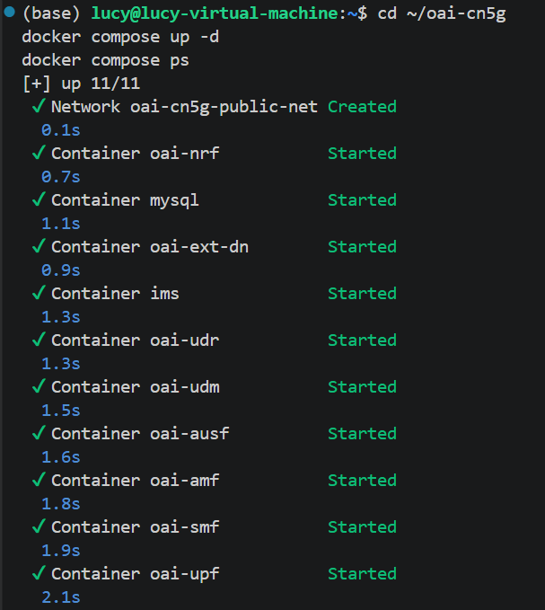

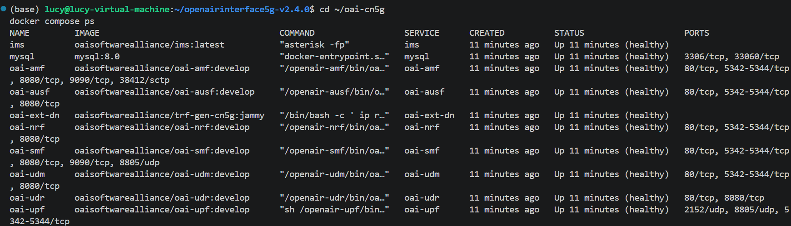

**Start the gNB:**

```bash
cd ~/openairinterface5g-v2.4.0/cmake_targets/ran_build/build
sudo ./nr-softmodem \
  -O ../../../targets/PROJECTS/GENERIC-NR-5GC/CONF/gnb.sa.band78.fr1.106PRB.usrpb210.conf \
  --gNBs.[0].min_rxtxtime 6 \
  --rfsim
```

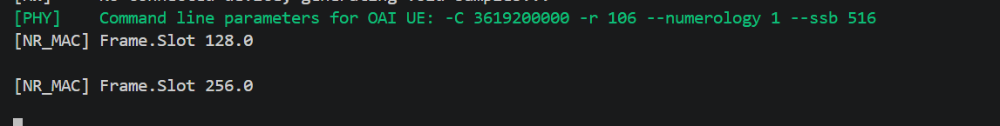

**Start the nrUE:**

```bash
cd ~/openairinterface5g-v2.4.0/cmake_targets/ran_build/build
sudo ./nr-uesoftmodem \
  -r 106 \
  --numerology 1 \
  --band 78 \
  -C 3619200000 \
  --uicc0.imsi 001010000000001 \
  --rfsim \
  --rfsimulator.serveraddr 127.0.0.1
```

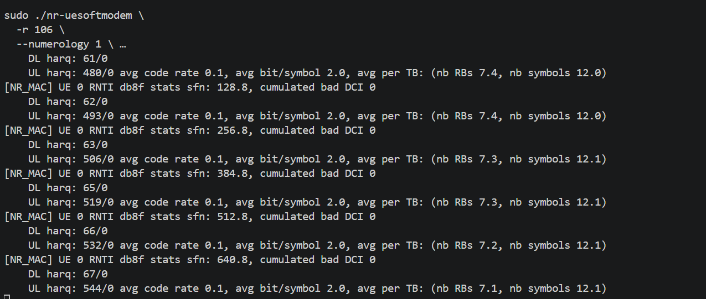

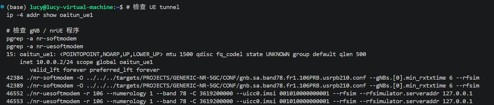

### 3.2 Connection Verification

| Connection Stage | Successful? | Evidence from Logs |
|---|:---:|---|
| CN5G initialization | Yes | All 10 Docker containers `healthy` |
| gNB NG Setup | Yes | AMF shows `gNB-OAI` as `Connected` |
| UE synchronization | Yes (indirect) | UE MAC activity observed; subsequent NAS signaling succeeds |
| RRC connection establishment | Yes (indirect) | Initial UE signaling reaches AMF and Registration succeeds |
| UE Registration | Yes | `5GMM-REGISTERED` |
| PDU Session Establishment | Yes | SMF: `PDU Session Status Active` (ID 10) |
| UE tunnel creation | Yes | `oaitun_ue1` configured with `10.0.0.2/24` |

*Note: Synchronization and RRC connection are inferred from subsequent successful signaling rather than directly shown by dedicated PHY/RRC log lines.*

### 3.3 Questions and Answers

**Q1. Does a successful NG Setup guarantee that a UE can register? Explain.**

**Answer:** No. A successful NG Setup only confirms that the gNB has established an NGAP connection with the AMF over the N2 interface. UE Registration still requires successful RRC connection establishment, NAS signaling, authentication, and security procedures. Therefore, NG Setup does not guarantee successful UE Registration.

**Q2. Why can the UE establish an RRC connection but still fail Registration?**

**Answer:** RRC connection establishment occurs between the UE and gNB, while UE Registration is handled by the 5G Core Network. Even if the RRC connection succeeds, Registration may fail due to an incorrect IMSI, missing subscriber information, authentication failure, or network configuration mismatch. Therefore, successful RRC establishment does not guarantee successful NAS Registration.

**Q3. What additional procedure is required after Registration before user data can be exchanged?**

**Answer:** After successful UE Registration, the UE must establish a PDU Session through the 5G Core Network. The SMF manages the session, and the UPF provides user-plane packet forwarding. Once the PDU Session is established and the required data path is configured, the UE can exchange IP packets with the External Data Network (DN). In this experiment, the SMF log showed `PDU Session Status Active`, and the UE tunnel interface `oaitun_ue1` was assigned `10.0.0.2/24`.

---

## 4. Task 2 — Investigate RFsimulator Communication

### 4.1 Procedure and Evidence

RFsimulator replaces the physical radio interface. The gNB and nrUE exchange IQ samples over a TCP connection.

**Check running processes:**

```bash
pgrep -a nr-softmodem
pgrep -a nr-uesoftmodem
```

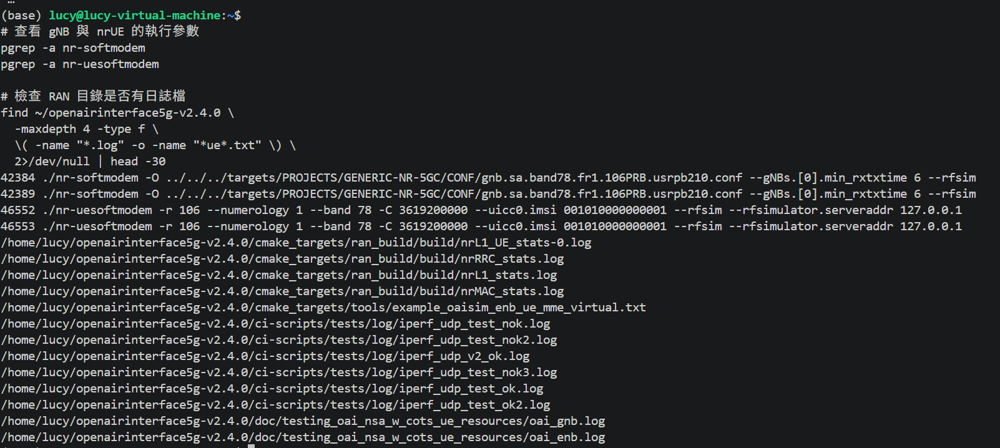

**Inspect the RFsimulator TCP connection:**

```bash
sudo ss -tnp | grep 4043
sudo ss -ltnp | grep 4043
```

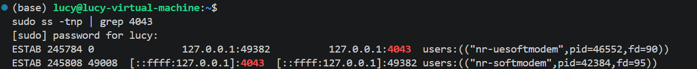

### 4.2 Observations

| Item | Observed Value |
|---|---|
| gNB process ID | `42384` |
| nrUE process ID | `46552` |
| RFsimulator transport protocol | TCP |
| RFsimulator port | `4043` |
| TCP connection state | `ESTAB` (Established) |
| Connected process(es) | `nr-softmodem`, `nr-uesoftmodem` |

### 4.3 Questions and Answers

**Q1. Why does RFsimulator use a TCP connection instead of a physical antenna? Explain.**

**Answer:** RFsimulator uses TCP to exchange IQ samples between the gNB and nrUE without requiring physical RF hardware or antennas. This allows the 5G protocol stack to be tested entirely in software. TCP provides a reliable transport mechanism for transferring the simulated radio samples between processes.

**Q2. Are the TCP packets exchanged by RFsimulator the same as the UE's application-layer IP packets?**

**Answer:** No. RFsimulator TCP packets carry IQ samples representing the simulated radio signals between the gNB and nrUE. The UE's application-layer IP packets are user-plane data transmitted through the 5G protocol stack and PDU Session. Therefore, RFsimulator TCP traffic and UE application traffic serve different purposes.

**Q3. Does using RFsimulator mean that the UE and gNB are performing no physical-layer processing? Explain.**

**Answer:** No. The gNB and nrUE still perform 5G NR physical-layer processing, including channel coding, modulation, OFDM processing, and signal decoding. RFsimulator only replaces the physical RF transmission interface with software-based IQ sample exchange. Therefore, the PHY processing remains functional even without actual antennas or RF hardware.

---

## 5. Task 3 — Verify End-to-End Connectivity

### 5.1 Procedure and Evidence

```bash
ip -4 addr show oaitun_ue1
ping -I oaitun_ue1 -c 10 192.168.70.135
```

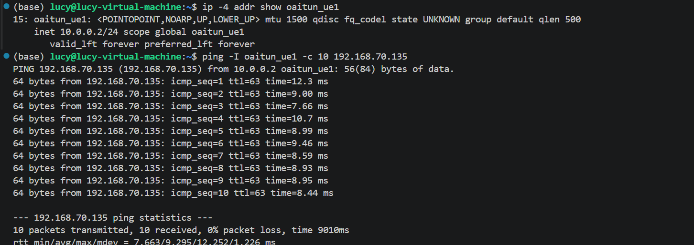

### 5.2 Baseline Ping Results

| Measurement | Observed Value |
|---|---:|
| UE IP address | `10.0.0.2` |
| Destination IP | `192.168.70.135` |
| Packets transmitted | 10 |
| Packets received | 10 |
| Packet loss (%) | 0% |
| Minimum RTT (ms) | 7.663 |
| Average RTT (ms) | 9.295 |
| Maximum RTT (ms) | 12.252 |

### 5.3 Questions and Answers

**Q1. Why must Ping use the `oaitun_ue1` interface in this experiment?**

**Answer:** The `oaitun_ue1` interface represents the UE's user-plane network interface associated with the established PDU Session. Using `-I oaitun_ue1` ensures that the ICMP packets originate from the UE tunnel and traverse the simulated 5G network instead of using the host's default network interface.

**Q2. Does successful Registration guarantee successful user-plane connectivity?**

**Answer:** No. Successful UE Registration only confirms that the UE has registered with the 5G Core Network. User-plane connectivity also requires successful PDU Session Establishment, IP configuration, and proper packet forwarding through the UPF. Therefore, Registration alone does not guarantee end-to-end communication.

**Q3. What does a successful Ping prove, and what does it not prove about the simulated 5G system?**

**Answer:** A successful Ping demonstrates that IP packets can travel between the UE and External DN through the established simulated 5G user-plane path. In this experiment, all 10 packets were received with 0% packet loss and an average RTT of 9.295 ms. However, this does not prove real over-the-air 5G performance because RFsimulator does not reproduce all physical wireless propagation conditions, hardware impairments, or real-world interference.

---

## 6. Task 4 — Investigate the Effect of Packet Size

### 6.1 Procedure and Evidence

Each scenario sends 30 ICMP packets at 0.2-second intervals through the established UE tunnel.

**Scenario A — Small packets (56 bytes):**

```bash
ping -I oaitun_ue1 -s 56 -c 30 -i 0.2 192.168.70.135
```

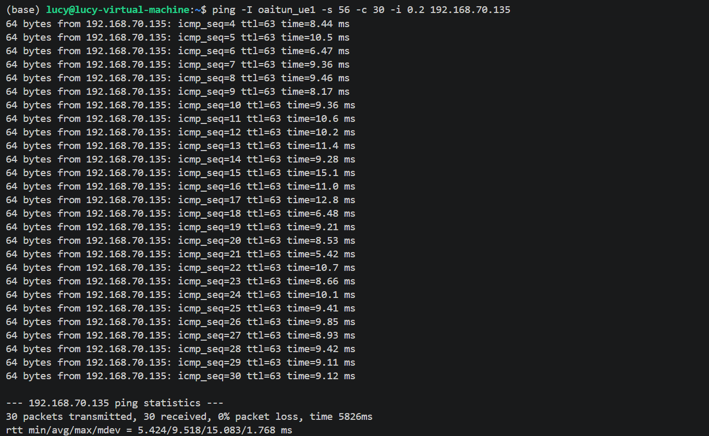

**Scenario B — Medium packets (512 bytes):**

```bash
ping -I oaitun_ue1 -s 512 -c 30 -i 0.2 192.168.70.135
```

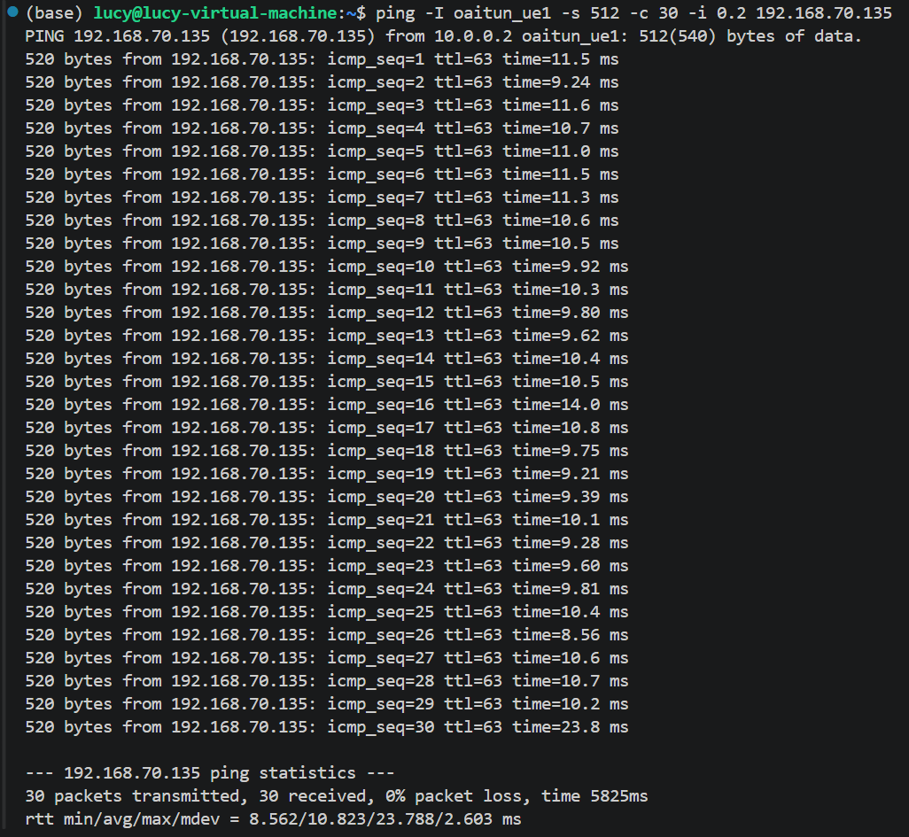

**Scenario C — Large packets (1200 bytes):**

```bash
ping -I oaitun_ue1 -s 1200 -c 30 -i 0.2 192.168.70.135
```

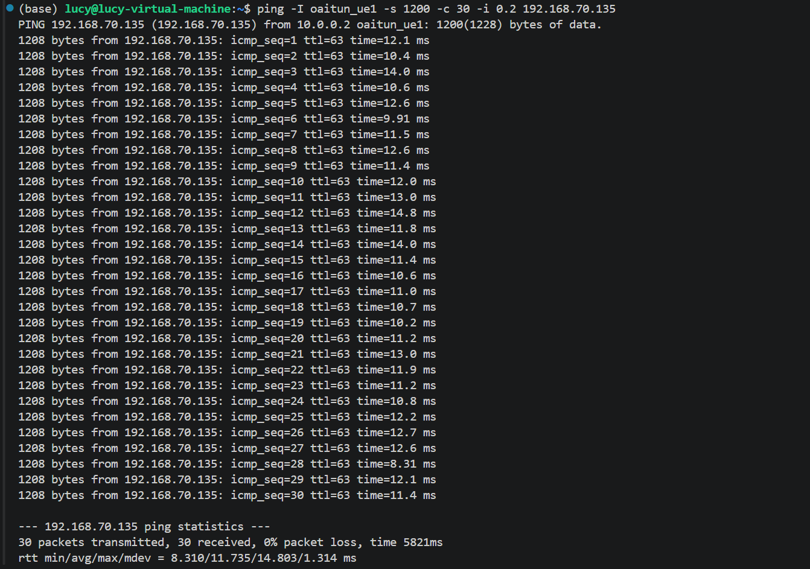

**Note:** `-s` specifies the ICMP payload size, not the total IP packet size.

### 6.2 Measurement Results

| Scenario | ICMP Payload | Avg. RTT (ms) | Max. RTT (ms) | Packet Loss (%) |
|---|---:|---:|---:|---:|
| A | 56 bytes | 9.518 | 15.083 | 0 |
| B | 512 bytes | 10.823 | 23.788 | 0 |
| C | 1200 bytes | 11.735 | 14.803 | 0 |

**RTT Difference Calculation:**

\[
\Delta RTT = RTT_{\mathrm{avg},C} - RTT_{\mathrm{avg},A}
= 11.735 - 9.518 = \boxed{2.217\ \mathrm{ms}}
\]

The average RTT increased by 2.217 ms (approximately 23.3%) when the ICMP payload increased from 56 to 1200 bytes.

### 6.3 Questions and Answers

**Q1. Which scenario has the highest average RTT?**

**Answer:** Scenario C (1200 bytes) has the highest average RTT of 11.735 ms. Scenario B (512 bytes) has an average RTT of 10.823 ms, while Scenario A (56 bytes) has the lowest average RTT of 9.518 ms.

**Q2. Does increasing packet size always increase RTT in your measurements?**

**Answer:** The measured average RTT increased as the packet size increased across all three scenarios. However, the maximum RTT did not follow the same trend. Scenario B recorded the highest maximum RTT of 23.788 ms, indicating that packet size is not the only factor affecting latency. Therefore, these results do not establish that larger packets always produce higher RTT.

**Q3. Why might a larger packet require more transmission or processing resources?**

**Answer:** A larger packet contains more data that must be processed and transmitted. In the 5G protocol stack, larger packets may require additional transport resources, such as more allocated resource blocks or processing capacity. This can increase transmission and processing time, potentially resulting in a higher RTT.

**Q4. What factors other than packet size could affect RTT in a software-based 5G network?**

**Answer:** RTT can also be affected by CPU utilization, operating system scheduling, virtual machine performance, network buffering, and software processing delays. Since RFsimulator runs the simulated radio communication in software, variations in host system workload may introduce additional latency. These factors can explain occasional RTT spikes even when the packet size remains unchanged.

**Q5. Can these results be interpreted as real over-the-air 5G latency? Explain.**

**Answer:** No. These measurements represent the latency of a software-based 5G SA network using OAI RFsimulator. Although the gNB and nrUE perform NR protocol processing, the experiment does not include physical RF hardware or realistic wireless propagation effects. Therefore, the measured RTT reflects the simulated environment and cannot be directly interpreted as real over-the-air 5G latency.

---

## 7. Task 5 — Diagnose a Controlled UE Registration Failure

**Important:** Save the original working UE command and do not modify the CN5G subscriber database.

### 7.1 Stop the UE and Modify the IMSI

Stop the original nrUE with `Ctrl+C`, keeping CN5G and the gNB running. Restart the nrUE with only its IMSI modified:

```bash
sudo ./nr-uesoftmodem \
  -r 106 \
  --numerology 1 \
  --band 78 \
  -C 3619200000 \
  --uicc0.imsi 001010000000099 \
  --rfsim \
  --rfsimulator.serveraddr 127.0.0.1
```

**AMF log inspection:**

```bash
cd ~/oai-cn5g
docker compose logs --since=2m oai-amf
```

### 7.2 Registration Failure Evidence

The AMF received a Registration Request for the incorrect IMSI `001010000000099`.

```text
Received IMSI 001010000000099
Get response with HTTP code (404)
"cause":"CONTEXT_NOT_FOUND"
Request Authentication Vectors failure
COMM-PROC-INIT -> 5GMM-DEREGISTERED
(event: [REGISTRATION_REJECT_SENT])
```

**Result: FAIL (Expected).** AUSF could not find the subscriber authentication context, and the AMF rejected the Registration Request.

### 7.3 Recovery Evidence

The UE was restarted with the original IMSI `001010000000001`.

```bash
--uicc0.imsi 001010000000001
```

**AMF log:**

```text
Received Security Mode Complete message
Encoding RegistrationAccept message
UE (IMSI 001010000000001) has been registered to the network
```

**Result: PASS.** Registration succeeded after restoring the original IMSI.

### 7.4 User-Plane Recovery

```bash
ip -4 addr show oaitun_ue1
ping -I oaitun_ue1 -c 10 192.168.70.135
```

**Ping log:**

```text
10 packets transmitted, 10 received, 0% packet loss
rtt min/avg/max/mdev = 8.570/11.295/21.133/3.484 ms
```

The UE tunnel was available at `10.0.0.2/24`, and all 10 ICMP packets were received successfully.


**Figure 4.** Successful UE tunnel and Ping verification after restoring the correct IMSI.

### 7.5 Failure Observation Table

| Item | Observation |
|---|---|
| Modified parameter | IMSI changed to `001010000000099` |
| UE synchronized with gNB? | Yes (inferred from subsequent NAS signaling) |
| RRC connection established? | Yes (inferred from Initial UE Message) |
| Registration successful? | No |
| Error or rejection evidence | AUSF HTTP 404, `CONTEXT_NOT_FOUND`, `REGISTRATION_REJECT_SENT` |
| Likely cause | IMSI not provisioned in subscriber database |

**Additional recovery screenshot from the original report:**

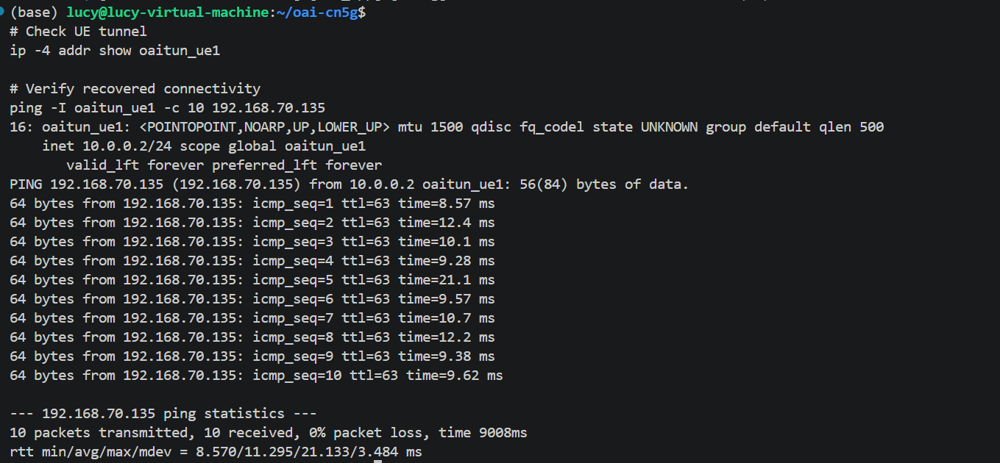

### 7.6 Questions and Answers

**Q1. Why can the UE potentially synchronize with the gNB even when the IMSI is incorrect?**

**Answer:** UE synchronization is a physical-layer procedure based on detecting synchronization signals transmitted by the gNB. It does not require subscriber identity verification. Therefore, the UE can synchronize with the gNB even when its IMSI is not registered in the 5G Core Network.

**Q2. Which network function is involved in UE authentication?**

**Answer:** The Authentication Server Function (AUSF) supports UE authentication in the 5G Core Network, working with the AMF and UDM. In this experiment, the AUSF returned HTTP 404 because the modified IMSI was not found.

**Q3. Why does changing an IMSI affect Registration but not the RFsimulator TCP connection itself?**

**Answer:** The IMSI identifies the subscriber during NAS Registration and authentication. RFsimulator TCP instead transports IQ samples between the gNB and nrUE. Changing the IMSI therefore affects subscriber authentication without directly changing the RFsimulator TCP transport.

**Q4. What evidence proves that restoring the correct configuration solved the problem?**

**Answer:** After restoring the IMSI to `001010000000001`, the AMF log reported that the UE had been registered to the network. The `oaitun_ue1` interface was available with IP address `10.0.0.2/24`. A recovery Ping to `192.168.70.135` received all 10 packets with 0% packet loss, demonstrating restored user-plane connectivity.

### 7.7 Conclusion

The controlled IMSI modification caused UE Registration to fail because the AUSF could not retrieve authentication information for the incorrect subscriber identity. After restoring the correct IMSI, Registration succeeded and IP connectivity recovered with 0% packet loss. The result shows that a functioning radio connection is not sufficient for successful core-network authentication.

---

## 8. Task 7 — Explain the Relationship Between Simulation and Real 5G

### 8.1 Comparison Table

| Feature | OAI RFsimulator | Physical 5G System |
|---|---|---|
| gNB and UE protocol stack | Implemented in software | Implemented in physical equipment |
| OFDM signal processing | Software-based OFDM processing | Hardware-assisted or software-based OFDM processing |
| Physical antennas | Not required | Required |
| RF hardware impairments | Not inherently reproduced | Present |
| Wireless propagation effects | Idealized or configurable channel models | Real-world wireless propagation |
| 5G Core connectivity | Supported | Supported |

### 8.2 Questions and Answers

**Q1. Which parts of the 5G system remain functional when physical RF hardware is replaced with RFsimulator?**

**Answer:** The 5G protocol stack remains functional, including the PHY, MAC, RLC, PDCP, RRC, and NAS layers. The gNB and nrUE can still perform synchronization, connection establishment, UE Registration, and PDU Session Establishment. RFsimulator replaces the physical radio transmission interface with TCP-based IQ sample exchange while retaining the main NR protocol processing procedures.

**Q2. Why is RFsimulator useful for testing the 5G protocol stack?**

**Answer:** RFsimulator allows researchers to test 5G network procedures without requiring expensive RF hardware or antennas. It provides a controlled and reproducible environment for analyzing protocol behavior, debugging signaling procedures, and validating end-to-end connectivity. It is particularly useful for investigating software implementation issues and network configuration errors.

**Q3. Why might latency and throughput differ between RFsimulator and a real 5G deployment?**

**Answer:** RFsimulator does not inherently reproduce all real-world wireless effects, such as interference, multipath fading, RF hardware impairments, and mobility-related channel variations. Its performance can also be influenced by CPU scheduling, virtual machine overhead, and software processing delays. Therefore, measured latency and throughput may differ significantly from those of a physical 5G deployment.

**Q4. What would need to change if you wanted to test a physical UE instead of OAI nrUE?**

**Answer:** The RFsimulator interface would need to be replaced with compatible RF hardware, such as a software-defined radio connected to the OAI gNB. The gNB would require suitable antennas, supported frequency bands, radio configuration, and synchronization settings. A physical 5G SA UE with a properly provisioned SIM or USIM would also be required to register with the 5G Core Network. All RF transmissions must comply with applicable spectrum regulations.

### 8.3 Conclusion

The OAI RFsimulator provides a software-based environment for testing 5G SA procedures without physical RF transmission. In this experiment, the simulated network supported UE Registration, PDU Session Establishment, and end-to-end IP connectivity. However, the measured performance reflects the software-based environment rather than actual over-the-air radio conditions.

---

## 9. Final Analysis

**Q1. Describe the complete process from starting the OAI 5GC to successful user-plane connectivity.**

**Answer:** First, the OAI 5GC was started with Docker Compose, and all ten containers passed their health checks. The gNB then connected to the AMF through NG Setup, while the nrUE synchronized and established a signaling connection with the gNB. The UE completed NAS Registration and authentication using the provisioned IMSI `001010000000001`. Next, the 5GC established a PDU Session and the UE obtained the `oaitun_ue1` interface with IP address `10.0.0.2/24`. Finally, a Ping to the External DN at `192.168.70.135` succeeded with 10 packets received and 0% packet loss.

**Q2. Explain the difference between an RFsimulator TCP connection and a 5G PDU Session.**

**Answer:** The RFsimulator TCP connection carries IQ samples between the OAI gNB and nrUE, substituting for a physical radio interface. In the experiment, this TCP connection used port `4043` and was observed in the `ESTAB` state. A 5G PDU Session is instead a logical user-plane service established through the 5G Core Network to carry the UE's IP traffic. The PDU Session depends on core-network signaling and data-path configuration, whereas the RFsimulator connection is the underlying software transport for radio samples.

**Q3. Based on your measurements, how did packet size affect RTT and packet loss?**

**Answer:** The average RTT increased from `9.518 ms` at 56 bytes to `10.823 ms` at 512 bytes and `11.735 ms` at 1200 bytes. The difference between the largest and smallest payload scenarios was `2.217 ms`, approximately a 23.3% increase. Packet loss remained at `0%` in all three 30-packet experiments. However, the highest maximum RTT (`23.788 ms`) occurred in the 512-byte scenario, showing that occasional delays did not increase monotonically with packet size.

**Q4. Describe the registration failure you introduced and explain how you diagnosed and recovered from it.**

**Answer:** The UE IMSI was intentionally changed from `001010000000001` to `001010000000099` without modifying the core-network subscriber database. The AMF received the Registration Request, but AUSF returned HTTP `404` with `CONTEXT_NOT_FOUND`, followed by `REGISTRATION_REJECT_SENT`. This identified a missing subscriber authentication context as the cause of the failure. After restoring the original IMSI, the AMF reported successful UE Registration. A subsequent Ping through `oaitun_ue1` received all 10 packets with 0% loss, confirming that user-plane connectivity had recovered.

**Q5. Identify two limitations of this simulated environment and explain how they might affect experimental results.**

**Answer:** One limitation is the absence of real RF hardware and antennas, so hardware impairments and real-world radio interference are not inherently represented. As a result, the measured connection performance may not reflect the reliability or behavior of a physical 5G deployment. A second limitation is that gNB, nrUE, and networking processes run on a shared software host or virtual machine, making latency sensitive to CPU load and operating-system scheduling. These software effects can influence RTT measurements independently of packet size or wireless-channel conditions.

---

## 10. Submission Checklist

- [x] 5G SA connection verification table
- [x] gNB and nrUE connection evidence
- [x] RFsimulator TCP connection evidence
- [x] Baseline Ping results
- [x] Three packet-size experiment results
- [x] RTT difference calculation
- [x] Registration failure and recovery logs
- [x] Recovery Ping result
- [x] RFsimulator vs. physical 5G comparison
- [x] Final Analysis (five questions)
