# Lab 4 

## Task 1 — Inspect the Split Configurations

### Procedure

The following commands verified the CU and DU configuration files and inspected the network and radio settings:

```bash
cd ~/openairinterface5g-v2.4.0

ls -l \
  targets/PROJECTS/GENERIC-NR-5GC/CONF/gnb-cu.sa.f1.conf \
  targets/PROJECTS/GENERIC-NR-5GC/CONF/gnb-du.sa.band78.106prb.rfsim.pci0.conf

grep -nE \
'absoluteFrequencySSB|dl_absoluteFrequencyPointA|dl_carrierBandwidth|physCellId|min_rxtxtime|local_s_address|remote_s_address|local_n_address|remote_n_address|local_s_portd|remote_s_portd|local_n_portd|remote_n_portd|amf_ip_address' \
  targets/PROJECTS/GENERIC-NR-5GC/CONF/gnb-cu.sa.f1.conf \
  targets/PROJECTS/GENERIC-NR-5GC/CONF/gnb-du.sa.band78.106prb.rfsim.pci0.conf
```

### Observed configuration

| Parameter | Observed value |
|---|---|
| RAN | One gNB-CU, one gNB-DU, one nrUE |
| Radio | RFsimulator, no SDR |
| Band | n78 |
| Channel bandwidth | 106 PRBs |
| Numerology / SCS | μ = 1 / 30 kHz |
| Physical cell ID | 0 |
| DU `absoluteFrequencySSB` | 630048 (3,450.72 MHz) |
| DU `dl_absoluteFrequencyPointA` | 628776 |
| DU `min_rxtxtime` | 4 |
| CU F1 address | 127.0.0.3 |
| DU F1 address | 127.0.0.4 |
| F1-U UDP port | 2152 |
| CU AMF configuration entry | 192.168.70.132 (configuration inspection) |
| CU NG/GTP-U address in startup log | 192.168.70.129 (runtime log) |

**Configuration note:** The inspected AMF-address field and the CU startup log contain different `192.168.70.x` addresses. The provided evidence does not establish why they differ. The CU nonetheless received an `NGSetupResponse` from the AMF. The runtime GTP-U address should not be mistaken for the F1-U endpoint (`127.0.0.3`).

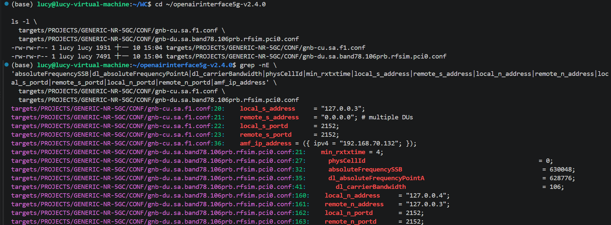

### Analysis questions

**Q1. Which protocol layers mainly reside in the CU, and which reside in the DU?**  
The gNB-CU mainly handles RRC and PDCP. The gNB-DU handles RLC, MAC, and PHY.

**Q2. What is the purpose of the F1 interface?**  
The F1 interface connects the gNB-CU and gNB-DU. F1-C carries control signaling using F1AP over SCTP. F1-U carries user-plane packets using GTP-U over UDP.

**Q3. Why must the UE radio frequency be compatible with the DU rather than taken blindly from the previous lab?**  
The DU provides the UE-facing radio interface. The UE needs compatible frequency and bandwidth settings to detect the cell, decode SSB/SIB1, and connect. The Lab 4 DU uses a 3,450.72 MHz SSB frequency, which differs from the 3,619.20 MHz value used in the Lab 3 monolithic configuration. Thus, the earlier UE `-C` setting must not be reused without verifying the DU.

## Task 2 — Deploy the Split 5G SA Network

### Deployment commands

**Terminal 1 — 5G Core**

```bash
cd ~/oai-cn5g
docker compose up -d
docker compose ps
```

**Terminal 2 — gNB-CU**

```bash
cd ~/openairinterface5g-v2.4.0/cmake_targets/ran_build/build
sudo ./nr-softmodem \
  -O ../../../targets/PROJECTS/GENERIC-NR-5GC/CONF/gnb-cu.sa.f1.conf
```

**Terminal 3 — packet capture, started before DU**

```bash
sudo tcpdump -i lo -s 0 -nn \
  -w ~/lab4-f1-complete.pcap \
  'host 127.0.0.3 and host 127.0.0.4 and (sctp or udp port 2152)'
```

**Terminal 4 — gNB-DU**

```bash
cd ~/openairinterface5g-v2.4.0/cmake_targets/ran_build/build
sudo ./nr-softmodem \
  -O ../../../targets/PROJECTS/GENERIC-NR-5GC/CONF/gnb-du.sa.band78.106prb.rfsim.pci0.conf \
  --rfsim
```

**Terminal 5 — nrUE**

```bash
cd ~/openairinterface5g-v2.4.0/cmake_targets/ran_build/build
sudo ./nr-uesoftmodem \
  -r 106 \
  --numerology 1 \
  --band 78 \
  -C 3450720000 \
  --uicc0.imsi 001010000000001 \
  --rfsim \
  --rfsimulator.serveraddr 127.0.0.1
```

### Key runtime evidence

The Docker Compose status showed the required CN5G services running and healthy. CU and DU both loaded their configurations successfully. The following selected log messages demonstrate the main milestones; full console output is omitted for readability.

**gNB-CU:**

```text
[CONFIG] function config_libconfig_init returned 0
[NGAP] Send NGSetupRequest to AMF
[NGAP] Received NGSetupResponse from AMF
[GNB_APP] Received NGAP_REGISTER_GNB_CNF: associated AMF 1
[F1AP] Starting F1AP at CU
[F1AP] F1AP_CU_SCTP_REQ(create socket) for 127.0.0.3 len 10
[GTPU] Initializing UDP for local address 127.0.0.3 with port 2152
```

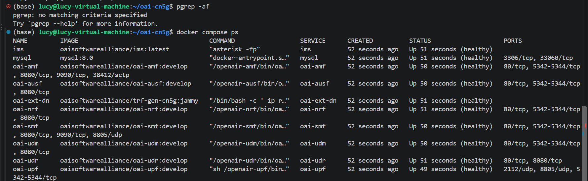

**gNB-DU:**

```text
[RRC] absoluteFrequencySSB 630048 corresponds to 3450720000 Hz
[F1AP] F1-C DU IPaddr 127.0.0.4, connect to F1-C CU 127.0.0.3, binding GTP to 127.0.0.4
[GTPU] Initializing UDP for local address 127.0.0.4 with port 2152
[MAC] received F1 Setup Response from CU cu-rfsim
[MAC] received gNB-DU configuration update acknowledge
[PHY] RU 0 RF started cpu_meas_enabled 0
```

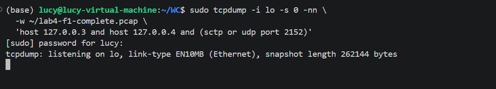

**nrUE:**

```text
[HW] Connection to 127.0.0.1:4043 established
[PHY] Initial sync successful, PCI: 0
[NR_RRC] SIB1 decoded
[MAC] Initialization of 4-Step CBRA procedure
[MAC] 4-Step RA procedure succeeded. CBRA: Contention Resolution is successful.
[NR_RRC] State = NR_RRC_CONNECTED
[NAS] Received Registration Accept with result 3GPP
[NAS] Received PDU Session Establishment Accept, UE IPv4: 10.0.0.2
[OIP] Interface oaitun_ue1 successfully configured, IPv4 10.0.0.2
```

**Observation:** The UE used **4-Step contention-based random access** in this lab. The UE successfully synchronized, decoded SIB1, completed RRC/NAS procedures, and obtained a PDU session and tunnel IP address.

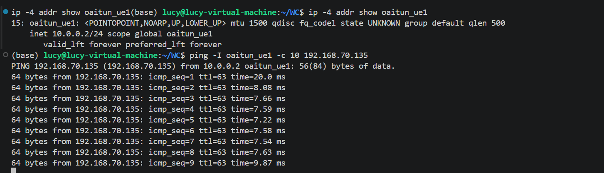

### End-to-end connection test

```bash
ip -4 addr show oaitun_ue1
ping -I oaitun_ue1 -c 30 -i 0.2 192.168.70.135
```

| Metric | Observed value |
|---|---|
| UE interface | `oaitun_ue1` |
| UE IPv4 | `10.0.0.2/24` |
| External DN | `192.168.70.135` |
| ICMP requests transmitted | 30 |
| ICMP replies received | 30 |
| Packet loss | **0%** |
| RTT minimum | 6.240 ms |
| RTT average | **7.492 ms** |
| RTT maximum | 9.197 ms |
| RTT mdev | 0.741 ms |

The successful Ping confirms end-to-end IP connectivity from the UE through the split RAN and 5GC to the external DN. It does not, by itself, identify which internal F1-U tunnel carried each individual ICMP packet; the PCAP provides separate interface-level evidence.

## Task 3 — Capture F1-C and F1-U in One PCAP

Packet capture started before DU initialization to preserve the SCTP and F1 Setup exchange. After UE registration and Ping traffic, tcpdump was stopped with `Ctrl+C`.

```text
tcpdump: listening on lo, link-type EN10MB (Ethernet), snapshot length 262144 bytes
174 packets captured
348 packets received by filter
0 packets dropped by kernel
```

```text
File: /home/lucy/lab4-f1-complete.pcap
Size: 26 KB
```

**Capture interpretation:** `174 packets captured` is the recorded packet count; `348 packets received by filter` is a tcpdump/kernel statistic and must not be added to the captured count. Wireshark identified **24 displayed F1AP packets** and **87 displayed GTP packets** in the capture. The one PCAP includes both control-plane and user-plane F1 traffic.

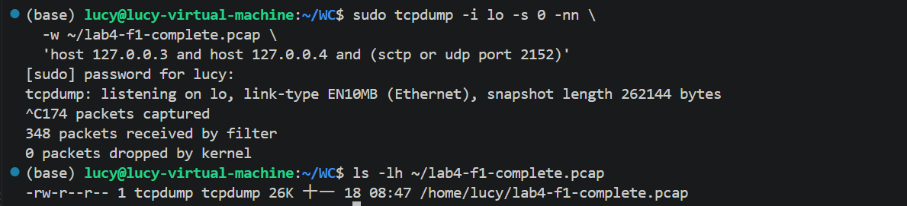

## Task 4 — Analyze F1-C (F1AP over SCTP)

### SCTP association establishment

Display filter: `sctp`

| Frame | Direction | SCTP message | Purpose |
|---|---|---|---|
| 1 | DU → CU | INIT | Starts SCTP association |
| 2 | CU → DU | INIT_ACK | Acknowledges association request |
| 3 | DU → CU | COOKIE_ECHO | Returns SCTP cookie |
| 4 | CU → DU | COOKIE_ACK | Completes SCTP handshake |

### F1 Setup and DU configuration

Display filter: `f1ap`

| Frame | Direction | F1AP message | Purpose |
|---|---|---|---|
| 5 | DU → CU | F1SetupRequest | Requests F1 establishment and reports served-cell information |
| 7 | CU → DU | F1SetupResponse | Accepts F1 Setup |
| 9 | DU → CU | GNBDUConfigurationUpdate | Sends DU configuration update |
| 10 | CU → DU | GNBDUConfigurationUpdateAcknowledge | Acknowledges configuration update |

The SCTP association and F1 Setup are distinct procedures. Frames 1–4 establish transport connectivity; frames 5 and 7 establish the F1 application relationship.

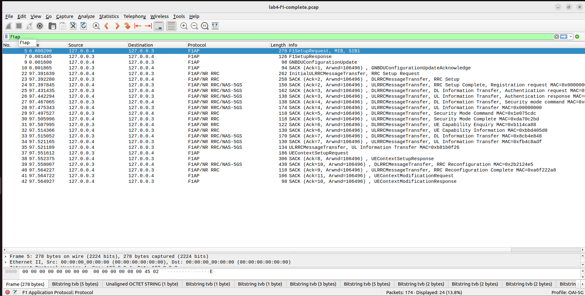

### UE-associated F1AP procedures

| Frame | Direction | Observed message |
|---|---|---|
| 22 | DU → CU | Initial UL RRC Message Transfer — RRC Setup Request |
| 23 | CU → DU | DL RRC Message Transfer — RRC Setup |
| 24 | DU → CU | UL RRC Message Transfer — RRC Setup Complete / NAS Registration Request |
| 25 | CU → DU | DL Information Transfer — Authentication Request |
| 26 | DU → CU | UL Information Transfer — Authentication Response |
| 37 | CU → DU | UE Context Setup Request |
| 38 | DU → CU | UE Context Setup Response |
| 39 | CU → DU | DL RRC Message Transfer — RRC Reconfiguration |
| 40 | DU → CU | UL RRC Message Transfer — RRC Reconfiguration Complete |
| 41 | CU → DU | UE Context Modification Request |
| 42 | DU → CU | UE Context Modification Response |

These frames demonstrate that UE-specific signaling is exchanged over F1-C after the CU–DU connection is established. In particular, frames 37–38 show UE Context Setup Request/Response.

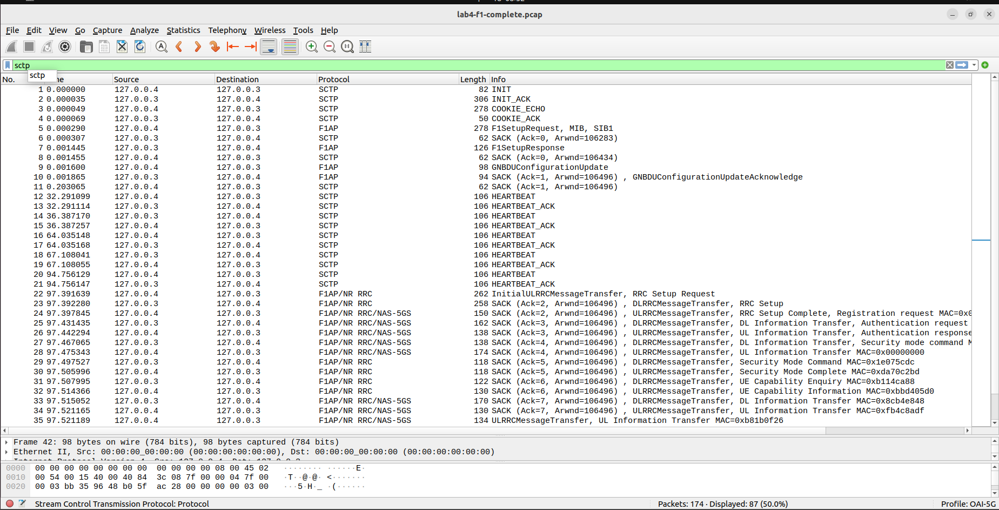

### Task 4 questions

**Q1. Which node initiates F1 Setup, and which acknowledges it?**  
The gNB-DU initiates F1 Setup using an F1 Setup Request (frame 5). The gNB-CU acknowledges it with an F1 Setup Response (frame 7).

**Q2. Explain the difference between SCTP association establishment and F1 Setup.**  
The SCTP handshake establishes a transport association between the CU and DU. F1 Setup is a subsequent F1AP procedure that exchanges application-level configuration for the F1 interface.

**Q3. How can a NAS Registration Request be transported over F1-C?**  
The UE places the initial NAS Registration Request in its RRCSetupComplete message. The DU transfers this RRC content to the CU using UL RRC Message Transfer (frame 24). The CU can then forward the NAS message to the AMF through NGAP.

**Q4. What is the role of UE Context Setup?**  
UE Context Setup coordinates UE-specific configuration and resources between the CU and DU. The observed Request/Response pair (frames 37–38) confirms the procedure was exchanged.

**Q5. Does F1 Setup alone prove successful UE Registration? Explain.**  
No. F1 Setup only verifies the CU–DU relationship. UE Registration requires UE signaling, authentication, and NAS procedures. In this experiment, the UE log separately showed Registration Accept and PDU Session Establishment Accept.

## Task 5 — Analyze F1-U (GTP-U over UDP)

### Packet-level inspection

Display filter: `gtp`

| Attribute | Uplink | Downlink |
|---|---|---|
| Representative frame | **70** | **71** |
| Direction | DU → CU | CU → DU |
| Outer source IP | 127.0.0.4 | 127.0.0.3 |
| Outer destination IP | 127.0.0.3 | 127.0.0.4 |
| UDP source/destination ports | 2152 / 2152 | 2152 / 2152 |
| GTP-U message type | T-PDU (`0xff`) | T-PDU (`0xff`) |
| TEID (hex) | **`0xb1d99e8c`** | **`0xc8432de8`** |
| TEID (decimal) | 2983829132 | 3359845864 |
| Captured frame size | 137 bytes | 149 bytes |
| GTP length | 87 | 99 |
| NR RAN container | Not shown in frame 70 | Present (`0x84`) |

The TEIDs are taken from the actual Wireshark packet details. A TEID identifies a GTP-U tunnel endpoint at the receiving node. UL and DL can use different TEID values.

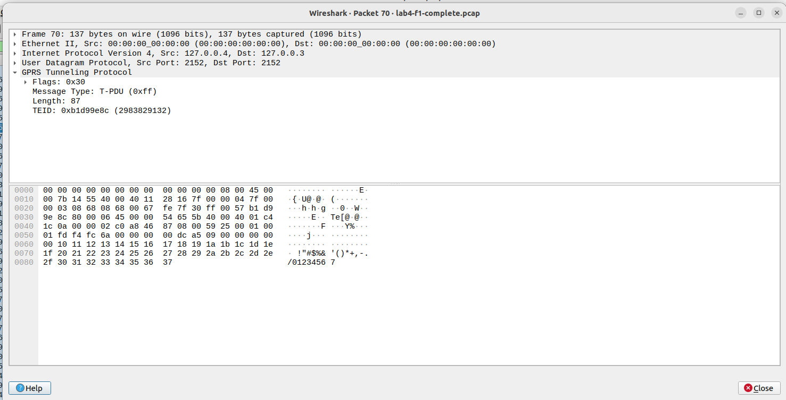

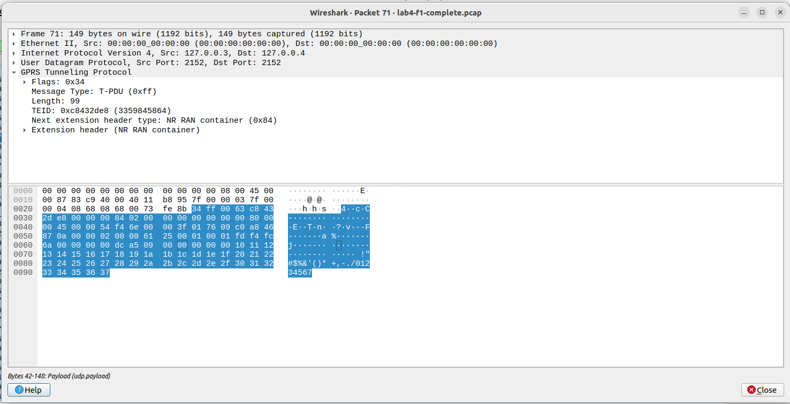

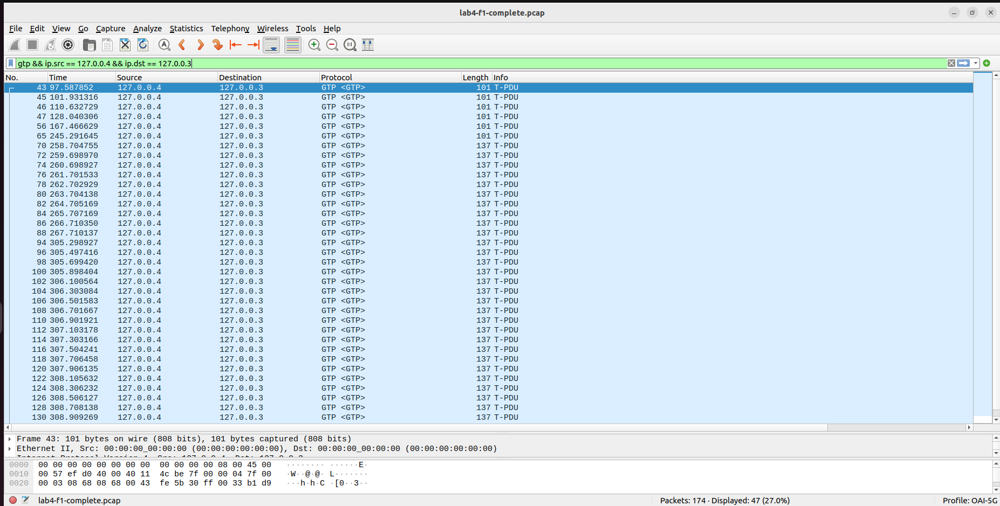

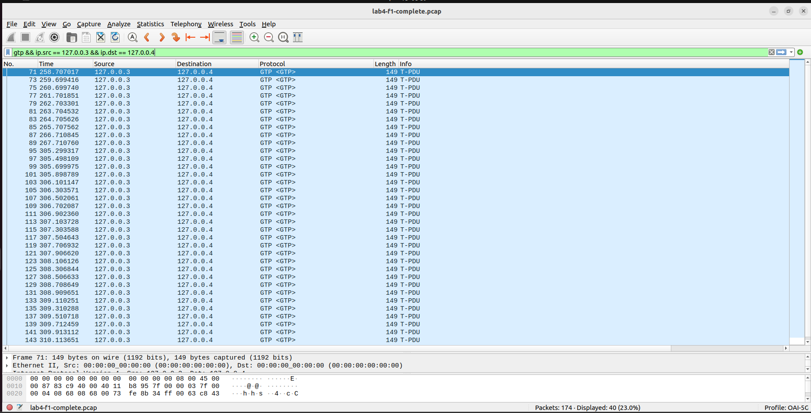

### UL/DL packet counts

The two Wireshark directional display filters produced these counts:

```text
gtp && ip.src == 127.0.0.4 && ip.dst == 127.0.0.3    → 47 packets (UL)
gtp && ip.src == 127.0.0.3 && ip.dst == 127.0.0.4    → 40 packets (DL)
```

| Category | Count |
|---|---:|
| F1-U UL GTP packets | **47** |
| F1-U DL GTP packets | **40** |
| Total GTP packets displayed | **87** |

The 47/40 split describes the captured GTP-U packets, not the success ratio of ICMP Ping. An unequal count is not sufficient evidence of packet loss. The independent 30-packet ICMP test reported 0% packet loss.

### Distinguishing F1-U from N3

F1-U and N3 both carry GTP-U traffic, often on UDP port 2152. The interface must be identified by its endpoints:

- **F1-U:** between gNB-DU (`127.0.0.4`) and gNB-CU (`127.0.0.3`) in this experiment.
- **N3:** between gNB-CU and the 5GC UPF, using a different endpoint pair.

The loopback capture filter selects traffic between the configured CU and DU, which supports classifying the displayed GTP T-PDUs as F1-U rather than N3.

### Task 5 questions

**Q1. Which transport protocol carries F1-U?**  
F1-U uses GTP-U over UDP. The observed packets use UDP port 2152.

**Q2. What does a GTP-U TEID identify?**  
A TEID identifies a tunnel endpoint at the receiving GTP-U node so that packets can be associated with the correct user-plane tunnel.

**Q3. Which direction is `127.0.0.4 → 127.0.0.3` in this setup?**  
It is the uplink direction, from gNB-DU to gNB-CU.

**Q4. How would you distinguish F1-U from N3 in a packet capture?**  
Check the actual IP endpoints against the configured nodes. F1-U connects DU and CU, while N3 connects CU and UPF. GTP-U or UDP port 2152 alone is not enough to distinguish them.

**Q5. Why do F1-C and F1-U use different transport protocols?**  
F1-C carries signaling and uses F1AP over SCTP, which provides association management and reliable transport. F1-U carries user-plane packets using GTP-U over UDP, supporting tunnel-based packet forwarding.

## Task 6 — Compare Monolithic and Split gNB

| Feature | Lab 3: Monolithic gNB | Lab 4: CU/DU Split |
|---|---|---|
| Number of RAN processes | One gNB process | Two RAN processes (CU + DU) |
| Location of RRC/PDCP | Within monolithic gNB | gNB-CU |
| Location of RLC/MAC/PHY | Within monolithic gNB | gNB-DU |
| F1-C interface present? | No | Yes — F1AP/SCTP observed |
| F1-U interface present? | No | Yes — GTP-U/UDP observed |
| UE connected to the same 5GC? | Yes (Lab 3 setup) | Yes (Lab 4 setup) |
| End-to-end Ping works? | Yes (Lab 3 result) | Yes — 30/30 replies |

Splitting the gNB separates RRC/PDCP from RLC/MAC/PHY and adds F1-C and F1-U between the CU and DU. The UE still needs radio synchronization and random access because it communicates with a radio cell provided by the DU. It also still performs RRC connection and NAS registration procedures to access the 5G Core. A PDU session remains necessary for IP traffic to the external DN. Therefore, the split changes the internal RAN implementation but does not eliminate the UE's access and session-establishment procedures.

## Final Analysis and Conclusion

The deployment and the packet capture confirm a working OAI 5G SA CU/DU split. SCTP frames 1–4 established the F1-C transport association, and F1AP frames 5 and 7 completed F1 Setup. UE-associated F1AP messages, including RRC Setup and UE Context Setup, were observed after the UE connected. On F1-U, 47 UL and 40 DL GTP-U packets were observed between the DU and CU; representative frames 70 and 71 carried distinct TEIDs. The UE completed 4-Step random access, NAS registration, and PDU session establishment, then successfully exchanged 30 ICMP Echo Requests and Replies with the external DN. The measured average RTT was 7.492 ms with 0% packet loss.

The observations establish correct F1 control-plane signaling, bidirectional F1 user-plane packet forwarding, and end-to-end UE connectivity in the tested configuration. These results are specific to the local RFsimulator deployment; they do not establish performance under real over-the-air radio conditions.

## Submission Checklist

- [x] CU/DU configuration and frequency inspection
- [x] CU/DU and nrUE deployment evidence
- [x] UE tunnel IP and Ping results
- [x] One PCAP: `lab4-f1-complete.pcap` (kept on the Ubuntu VM)
- [x] F1 Setup Request/Response evidence (frames 5 and 7)
- [x] Three or more UE-related F1AP messages
- [x] F1-U T-PDU and TEID evidence (frames 70 and 71)
- [x] F1-C / F1-U / N3 distinction
- [x] Monolithic versus split comparison
- [x] Answers to Task 1, Task 4, and Task 5 questions

**Attachment note:** The existing Markdown image references (`image.png`, `image-1.png`, …, `image-10.png`) are intentionally unchanged. Keep the original image files beside this `.md` report when submitting. The actual `lab4-f1-complete.pcap` resides in `/home/lucy/` on the experiment VM and must be submitted separately.
