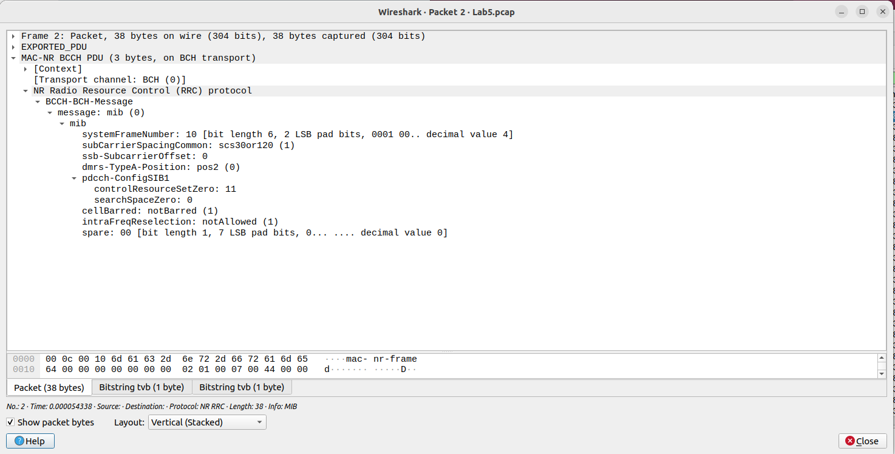
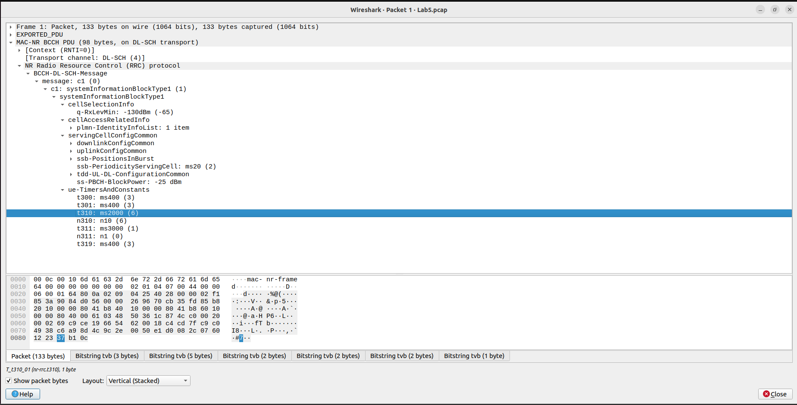
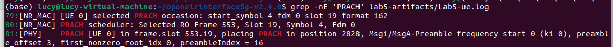
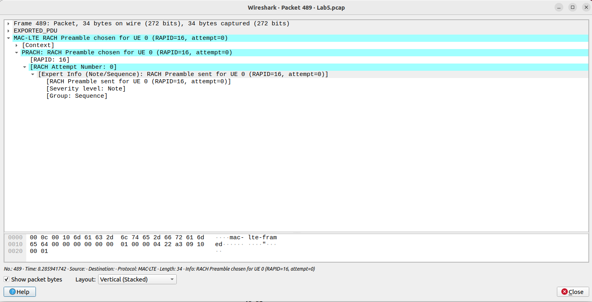
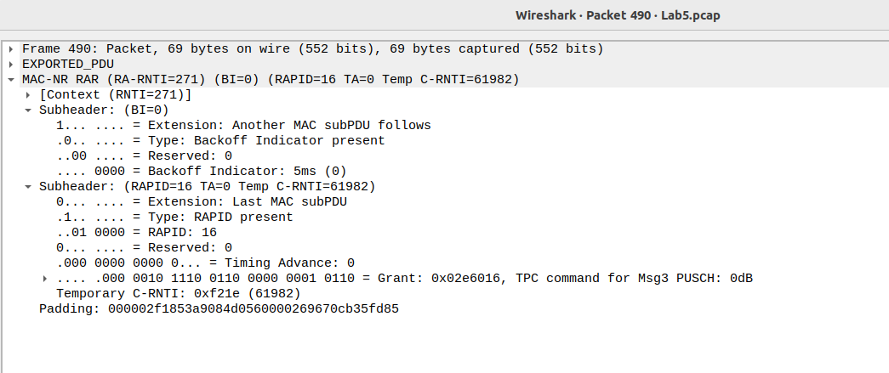
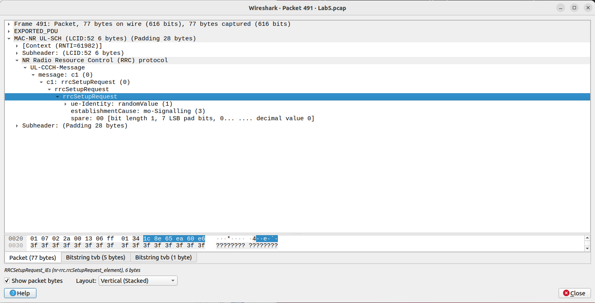
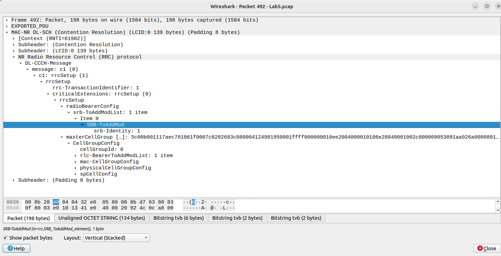
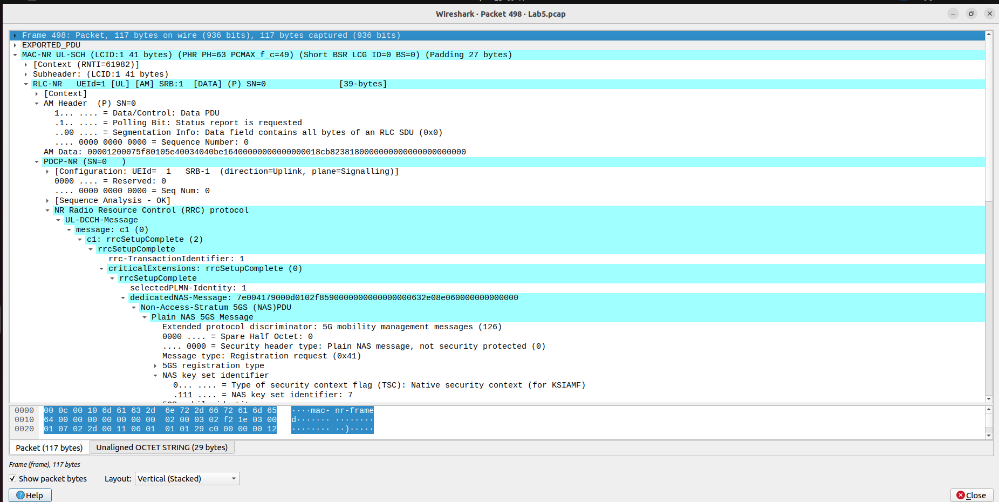
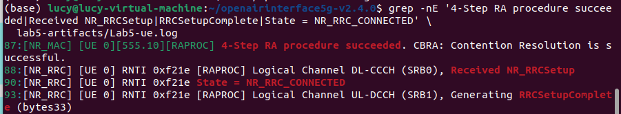
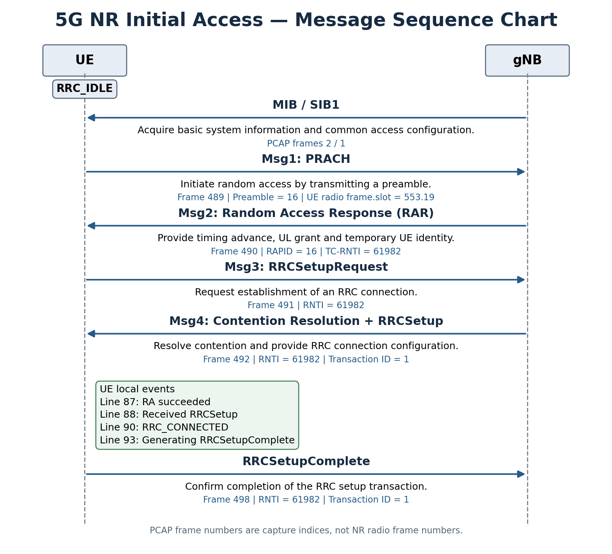

# Lab 5: From Initial Access to RRC Connection Setup

## Task 1: From Cell Search to Msg2 RAR (35 points)

### Step 1: Find Cell Search and Initial Synchronization (8 points)

**Command**

```bash
grep -nE 'Starting cell search|Initial sync successful' lab5-artifacts/Lab5-ue.log
```

**Result**

```text
56:[NR_PHY] Starting cell search with center freq: 3619200000, bandwidth: 106. Scanning for 1 number of GSCN.
63:[PHY]    Initial sync successful, PCI: 0
```

| Parameter | Result |
|---|---|
| Cell search log line | 56 |
| Initial synchronization log line | 63 |
| Synchronization result | Successful |
| Physical Cell ID (PCI) | 0 |

**Explanation:** The UE successfully synchronizes with the gNB and identifies the cell with PCI = 0. After initial synchronization, the UE can acquire the system information needed to obtain the common cell configuration and prepare for Random Access.

### Step 2: Find MIB and SIB1 (8 points)

**Wireshark display filter:** `nr-rrc`

| Message | Frame number | Transport channel | Direction |
|---|---:|---|---|
| MIB | 2 | BCH | gNB → UE |
| SIB1 | 1 | DL-SCH | gNB → UE |

#### MIB (Frame 2)



*Figure 1. Wireshark capture of the Master Information Block.*

**Explanation:** MIB provides essential cell information, including common subcarrier spacing, cell access status, and PDCCH configuration for acquiring SIB1. In this capture, `controlResourceSetZero = 11`, `searchSpaceZero = 0`, and `cellBarred = notBarred`. The UE uses this information to locate and decode SIB1.

#### SIB1 (Frame 1)



*Figure 2. Wireshark capture of System Information Block Type 1.*

**Explanation:** SIB1 provides cell access information and common uplink and downlink configurations, including the Random Access configuration required before PRACH transmission. The capture shows `q-RxLevMin = -130 dBm`, an SSB periodicity of 20 ms, and T300 = 400 ms.

The PCAP records SIB1 before MIB in the selected frames. Since both messages are periodically broadcast, their capture order does not establish the order in which a particular UE acquires system information. In the initial access procedure, the UE uses MIB to acquire SIB1.

### Step 3: Find Msg1 PRACH (8 points)

**Command**

```bash
grep -nE 'PRACH' lab5-artifacts/Lab5-ue.log
```

#### UE Log



*Figure 3. UE log showing PRACH occasion selection and preamble transmission.*

**Explanation:** Lines 79–80 show the selection and scheduling of the PRACH occasion. Line 81 shows the actual PRACH transmission at frame.slot 553.19 with preambleIndex = 16. The selected occasion starts at symbol 4 with FDM index 0.

#### Wireshark

**Search string:** `RACH Preamble chosen` (Packet details)



*Figure 4. OAI tracer PRACH event showing RAPID = 16 and attempt = 0.*

**Explanation:** Frame 489 records RAPID = 16, which matches the preamble index in the UE log. The MAC-LTE label is the OAI tracer event format and does not indicate that the experiment uses LTE Random Access.

| Parameter | Result |
|---|---|
| Msg1 log line | 81 |
| frame.slot | 553.19 |
| preambleIndex | 16 |
| Wireshark frame number | 489 |
| RAPID | 16 |
| RACH attempt number | 0 |

**Q1. Which Random Access message is this PRACH transmission?**

This is Msg1 of the four-step Random Access procedure.

**Q2. At which frame.slot and with which preambleIndex does the UE log show transmission?**

The UE transmits Msg1 at frame.slot 553.19 with preambleIndex = 16, as shown in line 81.

**Q3. Does the Wireshark RAPID match the UE-log preambleIndex? What does this show?**

Yes. Both values are 16, showing that the gNB tracer records the same preamble index as the UE transmission log.

### Step 4: Find Msg2 RAR in Wireshark (11 points)

**Search string:** `RAR` (Packet details)



*Figure 5. MAC-NR Random Access Response showing RAPID and Temporary C-RNTI.*

| Parameter | Result |
|---|---|
| Frame number | 490 |
| RAPID | 16 |
| Temporary C-RNTI (hexadecimal) | 0xf21e |
| Temporary C-RNTI (decimal) | 61982 |
| RA-RNTI | 271 |
| Timing Advance command | 0 |
| UL Grant | 0x02e6016 |

**Explanation:** Frame 490 shows Msg2 (RAR) transmitted by the gNB. RAPID = 16 matches the preamble index transmitted in Msg1. The RAR provides a Timing Advance command, an uplink grant for Msg3, and a Temporary C-RNTI of 0xf21e (61982). The UE can use these resources to transmit Msg3, but contention resolution and RRC connection establishment have not yet been completed.

### Task 1 Summary

| Stage | Evidence | Key result |
|---|---|---|
| Cell search / synchronization | UE log lines 56, 63 | Successful; PCI = 0 |
| MIB | PCAP frame 2 | Basic system information |
| SIB1 | PCAP frame 1 | Common cell configuration |
| Msg1 PRACH | UE log line 81; PCAP frame 489 | frame.slot = 553.19; preambleIndex = RAPID = 16 |
| Msg2 RAR | PCAP frame 490 | RAPID = 16; Temporary C-RNTI = 0xf21e (61982) |

The UE successfully performs initial synchronization, and the captured broadcast messages show the system information required for access. The matching preamble indices in the UE log, PRACH tracer event, and RAR establish consistent evidence of Msg1 and Msg2. The Temporary C-RNTI will be used to cross-check the subsequent RRC messages in Task 2.

---

## Task 2: Complete Random Access and RRC Connection Setup (40 points)

### Step 1: Find RRCSetupRequest (10 points)

Display filter: `nr-rrc.rrcSetupRequest_element`

| Parameter | Result |
|---|---|
| Frame number | 491 |
| Context RNTI | 61982 (0xf21e) |
| Establishment cause | mo-Signalling (3) |



**Figure 6.** Frame 491 shows Msg3 (RRCSetupRequest) transmitted by the UE on UL-CCCH.

**Q1. Does the Context RNTI match the Temporary C-RNTI in the RAR? What does this show?**

Yes. The Context RNTI (61982) matches the Temporary C-RNTI assigned in Frame 490. This links Msg3 to the preceding Random Access Response.

**Q2. Can you claim that the RRC connection has been established after seeing only RRCSetupRequest? Why or why not?**

No. RRCSetupRequest only indicates that the UE requests a connection. The UE must receive RRCSetup, apply its configuration, and send RRCSetupComplete.

### Step 2: Find RRCSetup (10 points)

Display filter: `nr-rrc.rrcSetup_element`

| Parameter | Result |
|---|---|
| Frame number | 492 |
| Context RNTI | 61982 (0xf21e) |
| rrc-TransactionIdentifier | 1 |
| Contention Resolution | Present |
| SRB identity | 1 |



**Figure 7.** Frame 492 contains a Contention Resolution MAC CE and RRCSetup in the same downlink MAC PDU. The RRCSetup configures SRB1.

**Q1. Which message is this in four-step Random Access?**

This is Msg4 of the four-step Random Access procedure.

**Q2. What does it mean that Contention Resolution and RRCSetup appear in the same downlink message?**

The gNB provides both the MAC-layer contention resolution information and the RRC-layer connection configuration in one downlink MAC PDU. The UE can verify its contention resolution identity and apply the RRC configuration.

### Step 3: Find RRCSetupComplete (12 points)

Display filter: `nr-rrc.rrcSetupComplete_element`

| Parameter | Result |
|---|---|
| Frame number | 498 |
| Context RNTI | 61982 (0xf21e) |
| rrc-TransactionIdentifier | 1 |
| Transport channel | UL-SCH |
| Logical channel | DCCH |
| Signalling radio bearer | SRB1 |



**Figure 8.** Frame 498 shows RRCSetupComplete carried over SRB1 through RLC-NR and PDCP-NR. The message also carries a NAS Registration Request, which does not establish that 5GC registration has completed.

**Q1. Does the Context RNTI still match the Temporary C-RNTI in the RAR?**

Yes. The Context RNTI in Frame 498 is 61982, matching the Temporary C-RNTI in Frame 490.

**Q2. Does the rrc-TransactionIdentifier match the RRCSetup in Step 2? What is the purpose of this comparison?**

Yes. Both Frame 492 and Frame 498 have transaction identifier 1. This verifies that RRCSetupComplete corresponds to the RRCSetup transaction initiated by the gNB.

### Step 4: Confirm the Final Random Access and RRC Connection Result (8 points)

```bash
grep -nE '4-Step RA procedure succeeded|Received NR_RRCSetup|RRCSetupComplete|State = NR_RRC_CONNECTED' lab5-artifacts/Lab5-ue.log
```

| Log message | Line number |
|---|---:|
| 4-Step RA procedure succeeded | 87 |
| Received NR_RRCSetup | 88 |
| State = NR_RRC_CONNECTED | 90 |
| Generating RRCSetupComplete | 93 |



**Figure 9.** The UE log confirms successful contention resolution, reception of RRCSetup on SRB0, transition to NR_RRC_CONNECTED, and generation of RRCSetupComplete on SRB1.

**Q1. In log order, what are the three events from successful Random Access to generating RRCSetupComplete?**

Following successful Random Access at line 87, the UE receives NR_RRCSetup (line 88), transitions to NR_RRC_CONNECTED (line 90), and generates RRCSetupComplete (line 93).

**Q2. What do `4-Step RA procedure succeeded` and `State = NR_RRC_CONNECTED` each prove?**

The first message confirms successful MAC-layer Random Access and contention resolution. The second confirms that the UE has entered the RRC connected state. Neither message establishes that 5GC registration is complete.

### Conclusion

The PCAP and UE log provide consistent evidence of successful four-step Random Access and RRC connection establishment. The RNTI remains numerically consistent at 61982 from Msg2 through RRCSetupComplete, and transaction identifier 1 matches between RRCSetup and RRCSetupComplete.

---

## Task 3: Initial Access MSC Diagram (25 points)



*Figure 10. Initial Access MSC reconstructed from the UE log and Wireshark evidence.*

| Message | Direction | Evidence | Purpose |
|---|---|---|---|
| MIB/SIB1 | gNB → UE | PCAP frames 2 and 1 | Acquire basic system information and common access configuration. |
| Msg1 PRACH | UE → gNB | Frame 489; log line 81 | Initiate random access using preamble 16. |
| Msg2 RAR | gNB → UE | Frame 490 | Provide timing advance, UL grant and temporary C-RNTI. |
| Msg3 RRCSetupRequest | UE → gNB | Frame 491 | Request an RRC connection. |
| Msg4 RRCSetup | gNB → UE | Frame 492 | Provide contention resolution and RRC configuration. |
| RRCSetupComplete | UE → gNB | Frame 498 | Confirm completion of the RRC setup transaction. |

The UE starts in RRC_IDLE. After Msg4, the UE log confirms successful contention resolution (line 87), reception of RRCSetup (line 88), transition to RRC_CONNECTED (line 90), and generation of RRCSetupComplete (line 93). The selected MIB and SIB1 frame numbers reflect capture order rather than the UE acquisition order.

## Final Analysis

The UE successfully synchronizes with PCI 0, completes four-step contention-based Random Access, and enters RRC_CONNECTED. The preamble index and RAPID match at 16. The temporary C-RNTI assigned in Msg2 and the subsequent context RNTI are numerically consistent at 61982 (0xf21e). The transaction identifier matches at 1 between RRCSetup and RRCSetupComplete. These observations establish consistent MAC and RRC evidence of successful initial access, but do not prove completion of 5GC registration or PDU session establishment.
